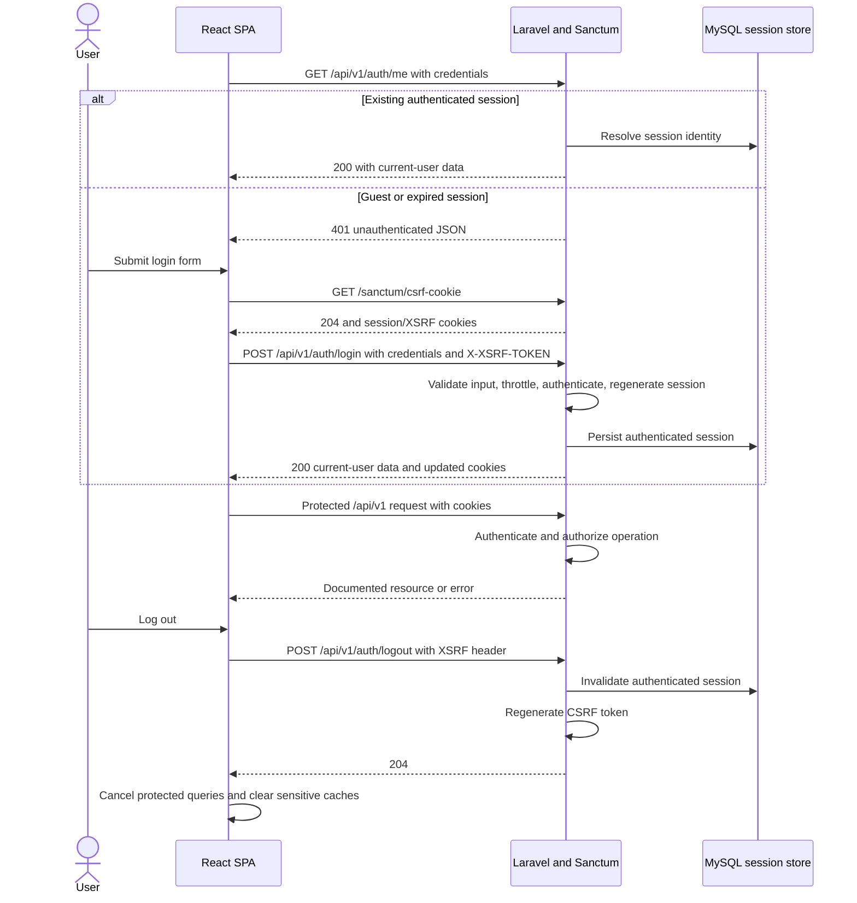

# Authentication Architecture

## Status and mandatory model

This document defines the approved future Laravel Sanctum SPA Cookie Authentication flow. The starter does not implement authentication endpoints, middleware, cookies, environment files, or tests. Everything below is design guidance for future implementation.

The SPA MUST authenticate using Laravel's server-side sessions and cookies. It MUST NOT use bearer-token login, JWT, refresh tokens, or localStorage/sessionStorage for session identifiers, passwords, or authentication credentials. Sanctum's optional personal-access-token functionality is outside the approved SPA scope and must not be exposed incidentally.

Sanctum identifies session-authenticated API requests; Laravel's session authentication services implement login and logout, while Policies enforce authorization. Sanctum alone does not provide the application's credential-validation controller or account lifecycle.

See [API conventions](api-conventions.md) for endpoint contracts, [frontend architecture](frontend.md) for state ownership, and [project scope](../scope.md).

## Origins, sites, and deployment constraints

An **origin** includes scheme, host, and port. A **site** concerns the scheme and registrable domain used by browser cookie policy. Different ports or subdomains can be cross-origin while remaining same-site; same-site is not the same as same-origin.

The SPA and API MUST share the same site domain for the documented Sanctum SPA model. Production supports either a same-origin public entry point or HTTPS frontend/API subdomains under a common trusted parent domain. Arbitrary unrelated hosting domains are not an approved topology. Setting `SameSite=None` or disabling CSRF is not an approved workaround.

No production domains, provider, proxy, or CDN are selected by these examples. Same-origin routing reduces CORS and cookie-scope complexity. Separate subdomains require credentialed CORS and cookie-domain configuration and extend trust to the shared-cookie domain's hosts.

## Documented endpoint boundary

| Method and endpoint | Access | Success | Important failures |
| --- | --- | --- | --- |
| `GET /sanctum/csrf-cookie` | First-party browser bootstrap | `204`; initializes XSRF and session cookies | Network or origin/configuration failures |
| `POST /api/v1/auth/login` | First-party session context; credentials and CSRF protection required | `200`; current-user Resource under `data` | `422` invalid input or credentials; `419` token mismatch; `429` throttling |
| `GET /api/v1/auth/me` | `auth:sanctum` | `200`; current-user Resource under `data` | `401` unauthenticated |
| `POST /api/v1/auth/logout` | `auth:sanctum`; CSRF protection required | `204`; session invalidated | `401`, `419` |

`/sanctum/csrf-cookie` is a framework-owned, unversioned bootstrap endpoint and an explicit exception to the `/api/v1` application prefix. It MUST still appear in the future OpenAPI contract. Do not create undocumented `/login`, `/logout`, or `/user` aliases when implementing the versioned paths.

User Resource fields beyond an approved minimal representation require product review before implementation. Do not infer roles, tenant information, registration, or account-management endpoints from these examples.

## Authentication lifecycle

### Startup and current user

The current-user TanStack Query is the canonical identity source. Its initial state is unresolved, not automatically guest. A `401` from `/api/v1/auth/me` establishes the guest state and must not trigger retry or redirect loops.

A network error does not prove that the user is logged out. Show a recoverable connectivity state and avoid exposing protected screens before identity is known. After a successful login, seed or refetch the same current-user query; do not create a competing authentication store.

### CSRF initialization and login

Before submitting credentials, request `/sanctum/csrf-cookie` from the backend origin with credentials enabled. Axios reads the resulting `XSRF-TOKEN` cookie and sends its decoded value in `X-XSRF-TOKEN` when configured for the cross-origin backend request.

Laravel MUST validate the input, apply a reviewed login throttle, authenticate using its standard session guard, and regenerate the session ID on success. Invalid credentials return `422` with the stable `invalid_credentials` code and a generic message that does not disclose account existence. Ordinary structural input failures use `validation_failed`.

The versioned login route MUST execute within a session-enabled, request-forgery-protected pipeline for configured first-party requests. Sanctum's stateful API setup supplies that integration for recognized browser origins. Do not combine duplicate session pipelines blindly, exempt the route from CSRF, or issue a token as a shortcut. Calls outside the required stateful request context must fail safely with a documented client error rather than authenticate through a bypass or cause an internal server error.

### Protected API requests

Protected routes use `auth:sanctum`. Recognized first-party requests use the Laravel session cookie. Each operation still applies its backend authorization rules. Sanctum token-ability checks do not establish a SPA user's resource permissions.

Only validated, public user fields may be returned. Authentication and current-user responses MUST prevent shared-cache storage; use appropriate private/no-store response policy for sensitive identity data.

### Logout and identity changes

Logout uses the session guard, invalidates the authenticated session, and regenerates the CSRF token before returning `204`. An anonymous session or new CSRF cookie may remain afterward; success means the old authenticated state is unusable, not that every cookie disappeared.

The frontend MUST prevent new protected requests during identity transitions, propagate cancellation to relevant in-flight queries, and clear sensitive query and mutation state on logout or confirmed expiry. A different user must never see the previous user's cached data. Already submitted mutations cannot be undone by clearing a client cache; old callbacks must not repopulate a new identity's cache.

If logout fails due to connectivity, the interface MUST NOT claim the server session was invalidated. It may hide local sensitive state and offer retry, while explaining that server logout could not be confirmed.

### Expiry, failures, and retries

- `401`: enter the guest state when authentication is required; clear protected state without repeated redirects.
- `403`: display a permission failure and keep the authenticated identity.
- `419`: treat as a CSRF/session mismatch; refresh CSRF and identity state as needed and require an explicit retry.
- `422`: show field or form errors; distinguish invalid credentials through the stable code.
- `429`: display a throttling message and honor `Retry-After`.

Do not automatically replay login, logout, or business mutations after `401` or `419`. Query retries for these statuses are disabled. There is no refresh-token flow.

## Laravel 13 request-forgery behavior

Laravel 13's default request-forgery protection checks browser-origin metadata and falls back to CSRF token validation. A valid same-origin request can be accepted through origin verification without a token. A cross-origin same-site SPA request still needs the normal token fallback under the approved default behavior.

Keep this default model. Do not enable origin-only mode, broadly allow same-site bypass, or exclude `/api/*` from protection. The origin metadata is supplied by the browser; tests must not fabricate same-origin metadata and then claim to have verified an attacker-origin case.

Sanctum stateful recognition, browser cookie policy, CORS, CSRF protection, and authorization solve different problems. None substitutes for the others. In particular, CORS may prevent JavaScript from reading a response without preventing a request from being sent.

## Local development configuration

These are illustrative future settings for direct cross-origin development. They are not `.env` files and do not configure the current repository.

| Setting | Local example | Meaning |
| --- | --- | --- |
| Frontend origin | `http://localhost:5173` | Vite SPA origin |
| Backend origin / `APP_URL` | `http://localhost:8000` | Laravel public origin |
| `VITE_API_ORIGIN` | `http://localhost:8000` | Public frontend configuration; no API path prefix |
| `SANCTUM_STATEFUL_DOMAINS` | `localhost:5173` | Frontend host and port; no scheme or path |
| CORS allowed origin | `http://localhost:5173` | Exact origin including scheme and port |
| `SESSION_DRIVER` | `database` | Server-side sessions in MySQL |
| `SESSION_DOMAIN` | `null` | Host-only cookies for local development |
| `SESSION_PATH` | `/` | Applies across application and bootstrap paths |
| `SESSION_COOKIE` | `app_session` | Illustrative cookie name; match the OpenAPI security scheme |
| `SESSION_SECURE_COOKIE` | `false` | Local HTTP only; never copy this to production |
| `SESSION_HTTP_ONLY` | `true` | Prevent JavaScript access to the session cookie |
| `SESSION_SAME_SITE` | `lax` | Intended same-site local topology |

Use `localhost` consistently. Do not mix it with `127.0.0.1` between public SPA and API URLs. Cookie hosts are not isolated by port, so use an application-specific session cookie name when several local applications share a host. The table's name is illustrative, not a claimed existing configuration.

The session idle lifetime is a product/security decision to confirm before production; do not infer a production lifetime from a framework default. MySQL credentials and application encryption keys must be supplied securely during setup, never embedded in this documentation or frontend configuration.

## Production configuration and domain considerations

The following examples describe alternatives, not selected deployment domains:

| Concern | Same-origin alternative | Same-site subdomain alternative |
| --- | --- | --- |
| Public frontend | `https://app.example.com` | `https://app.example.com` |
| Public API | Same origin with `/api/v1` routed to Laravel | `https://api.example.com/api/v1` |
| CSRF bootstrap | Same origin, `/sanctum/csrf-cookie` routed to Laravel | `https://api.example.com/sanctum/csrf-cookie` |
| Cookie domain | Host-only when feasible | Shared parent such as `.example.com` for the documented Axios XSRF-cookie flow |
| CORS | No cross-origin permission needed for same-origin calls | Exact frontend allowlist and credentials enabled |
| Transport | HTTPS | HTTPS on both origins |
| Session cookie | `Secure`, `HttpOnly`, `SameSite=Lax` | `Secure`, `HttpOnly`, `SameSite=Lax` |

Shared-cookie domains allow the readable XSRF cookie to reach the SPA and the session cookie to reach the API. They also extend trust to hosts under that parent. Do not host untrusted tenant content there or share cookie scope across environments unnecessarily. Use distinct cookie names and suitably narrow environment domains to prevent staging/production collisions.

Configure trusted proxies only for actual infrastructure so Laravel correctly detects HTTPS and produces secure URLs and cookies. Keep application encryption configuration consistent across backend instances and use the shared database session store. The starter creates no proxy or provider configuration.

## Credentialed CORS and stateful domains

The future backend configuration MUST:

1. Enable Sanctum's `statefulApi` integration in Laravel's bootstrap.
2. List approved frontend hosts in Sanctum's stateful-domain configuration, including non-default ports; omit schemes and paths there.
3. Allow exact full frontend origins in CORS, with `supports_credentials` enabled. Never combine credentialed CORS with wildcard origins or reflection of arbitrary origins.
4. Cover `api/*` and `sanctum/csrf-cookie` in CORS paths, including error responses.
5. Allow required methods and headers such as `Accept`, `Content-Type`, and `X-XSRF-TOKEN`. Allow `X-Requested-With` only if used. Expose response headers such as `Retry-After` if the client reads them.
6. Permit preflight `OPTIONS` processing without an authenticated session and without unintended redirects.
7. Preserve browser `Origin` or `Referer` metadata needed for stateful recognition, and return JSON for application API failures.

Use a backend-specific Axios instance with `withCredentials: true` and `withXSRFToken: true`. These settings have different roles: one enables credentialed requests; the other enables the XSRF header for the trusted cross-origin API. Neither alone establishes authentication.

## Browser and account security

- The session cookie MUST be `HttpOnly`. The `XSRF-TOKEN` cookie is intentionally readable and is not a bearer credential.
- `HttpOnly` reduces session-cookie theft but does not make XSS harmless: injected scripts could still act as the user. Use safe rendering, reviewed dependencies, and appropriate browser security headers during deployment hardening.
- Never log passwords, session IDs, CSRF tokens, or full credential-bearing requests. Disable production debug responses.
- Use framework password hashing and safe credential comparison. Apply login throttling with reviewed identity/IP behavior and non-enumerating failure messages.
- Validate local return paths to prevent open redirects. Protect sensitive output through explicit Resources and backend Policies.
- Registration, password recovery, email verification, MFA, persistent login, roles, and tenancy require explicit product decisions. Do not implement them implicitly.

## Authentication testing requirements

| Layer | Required checks |
| --- | --- |
| Pest feature tests | Input validation, generic credential failure, login success, session regeneration, current-user contract, logout invalidation, unauthenticated access, throttling, and Policy outcomes |
| Vitest | Guest/loading/authenticated/connectivity states, form errors, status handling, cancellation integration, stale-identity callbacks, and cache clearing |
| Playwright with live servers | CSRF bootstrap, actual cookie attributes and host scope, cross-origin login, protected requests, reload persistence, logout, expiry, and two-user cache isolation |
| Negative browser/security cases | Disallowed origin lacks credentialed response access; attempts cannot perform protected state changes; trusted cross-origin same-site unsafe requests fail without a valid XSRF header under the default token fallback |

Ordinary Laravel HTTP tests bypass CSRF by default, and mocked HTTP clients do not enforce browser cookie/CORS rules. Browser tests MUST use real servers with request-forgery protection active in an isolated E2E environment. Merely applying `withMiddleware` in a unit-test environment may not remove the framework's testing bypass.

Test same-origin origin-verification behavior separately from cross-origin token-fallback behavior. Do not require a same-origin request accepted by Laravel's default origin verification to fail with `419`. Do not treat a CORS console error alone as proof that a state-changing operation was blocked.

Use isolated MySQL data and non-production accounts. HTTPS cookie and subdomain behavior must be checked in a controlled HTTPS environment before production readiness; local HTTP alone does not prove those properties.

## References

- [Architecture overview](overview.md)
- [Backend architecture](backend.md)
- [Frontend architecture](frontend.md)
- [API conventions](api-conventions.md)
- [Project scope](../scope.md)
- [Laravel Sanctum SPA authentication](https://laravel.com/docs/13.x/sanctum)
- [Laravel session authentication](https://laravel.com/docs/13.x/authentication)
- [Laravel 13 request-forgery protection](https://laravel.com/docs/13.x/csrf)
- [Laravel HTTP tests](https://laravel.com/docs/13.x/http-tests)
