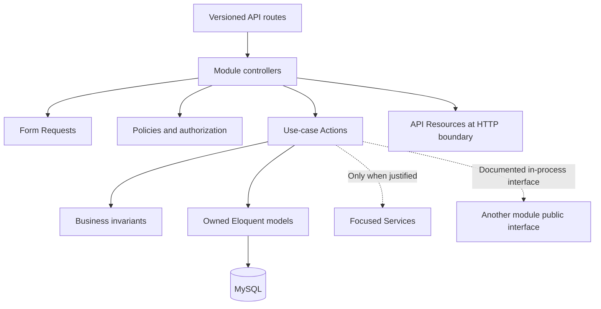

# Backend Architecture

## Status and governing decisions

This describes the `BE/` Laravel 13 application. The starter includes the framework foundation; business modules remain planned. See the [overview](overview.md) for the stack and terminology, [agent instructions](../../AGENTS.md) for repository rules, and [project scope](../scope.md).

The backend MUST remain independently executable and deployable. Its installation, tests, and production preparation MUST NOT depend on Node.js, frontend assets, or a running frontend. Do not adopt an Inertia or Livewire application structure for this decoupled API.

## Modular Monolith approach

The backend is one Laravel application, with explicit capability boundaries inside the process. It starts with one MySQL database and database-backed sessions. It does not require microservices, independent module deployments, internal HTTP clients, or distributed transactions.

The first supporting module is `Identity`, responsible for accounts and session-related use cases. Business capabilities and module names require confirmed product requirements before implementation.



Authorization checks may be initiated at the HTTP boundary, but every externally callable path must enforce the same permission requirements. An Action reused from a command, job, or another module MUST NOT silently bypass required actor authorization.

## Planned directory structure

```text
BE/
├── readme.md                         # Existing file; preserve
├── app/
│   ├── Modules/
│   │   └── Identity/
│   │       ├── Actions/              # Login, logout, and approved account use cases
│   │       ├── Http/
│   │       │   ├── Controllers/
│   │       │   ├── Requests/
│   │       │   └── Resources/
│   │       ├── Models/
│   │       ├── Policies/
│   │       └── Routes/api.php
│   ├── Providers/
│   │   ├── AppServiceProvider.php
│   │   └── ModuleServiceProvider.php
│   └── Support/                      # Shared infrastructure with proven reuse
├── bootstrap/
├── config/
├── database/
│   ├── factories/
│   ├── migrations/
│   └── seeders/
├── public/
├── routes/
│   ├── api.php
│   └── console.php
├── storage/
├── tests/
│   ├── Architecture/
│   ├── Feature/Identity/
│   └── Unit/Identity/
├── composer.json
├── composer.lock
└── phpunit.xml
```

Only create folders that have actual content. Add `Services/`, `Contracts/`, `Data/`, `Events/`, or `Jobs/` inside an owning module when a demonstrated use case needs them. Do not force Domain/Application/Infrastructure layers into every module.

## Module registration and dependency rules

- Use the existing `App\` PSR-4 root with module namespaces such as `App\Modules\Identity`. No module package is required.
- Use explicit module registration in `ModuleServiceProvider`, registered through Laravel's provider bootstrap. Avoid runtime directory scanning and implicit plugin discovery.
- Load module API routes through the central API route composition, applying `/api/v1` exactly once. Module route files declare their own resource paths, not another full API prefix.
- Enable Sanctum's stateful API middleware in the Laravel 13 bootstrap when authentication is implemented. Do not copy obsolete HTTP-kernel instructions from earlier Laravel layouts.
- Module route names SHOULD identify the API version and module to avoid collisions.
- A module's public interfaces are explicitly documented Actions or contracts. Placement in an `Actions/` directory alone does not make every class public to other modules.
- Cross-module callers MUST NOT import another module's Models, Controllers, Form Requests, or Resources, or perform direct reads or writes against its owned tables.
- Pass identifiers and narrow data representations across public boundaries. Keep Eloquent models internal to the owning module.
- Dependencies MUST remain acyclic. A cross-module workflow belongs in an explicitly chosen coordinating use case and calls the participating public interfaces.
- Do not introduce an interface and implementation pair solely because a class might change later.

If a future Identity module is introduced, move ownership deliberately and update authentication configuration, factories, policies, and tests. Do not maintain competing user models.

## HTTP and application responsibilities

### Controllers

Controllers MUST remain thin adapters. They receive validated input and the authenticated actor, invoke the owning use case, and return a Resource or the appropriate empty response. They must not contain substantial business rules, raw SQL workflows, or frontend-specific presentation logic.

Use a single-action controller when it clarifies a use case; do not require one class per trivial operation as an end in itself.

### Form Requests

Form Requests define accepted input, structural validation, normalization that is part of the API contract, and relevant request authorization. Use validated input rather than forwarding the complete request payload into a model.

Separate malformed input from business invariants. A valid field shape does not establish ownership, permission, availability, or a valid state transition. Zod schemas in the SPA do not replace these checks.

### Actions

An Action represents a meaningful business operation, not a generic persistence wrapper. It owns business invariants, the appropriate transaction boundary, and coordination with owned Models or documented public module interfaces.

Actions SHOULD accept narrow, typed inputs and return explicit results. They SHOULD NOT depend on an HTTP Request, response envelope, controller, or frontend route. Introduce a DTO only when it materially clarifies an input or result; ordinary typed arguments can be sufficient.

Authorization requirements MUST be explicit at a reusable use-case boundary. Either enforce the relevant Policy within that boundary or require a documented caller authorization contract with tests covering every entry point. Do not assume a queued job or command passed through HTTP authorization.

### Services when justified

A Service is appropriate for a focused behavior shared by multiple use cases, an external integration, or a cohesive calculation that does not belong to one model. Give it a precise responsibility and name.

Do not add a Service between every controller and Action, create a generic `BaseService`, or introduce a Repository Pattern by default. Eloquent is the default persistence abstraction.

### Models and Eloquent

Models own persistence mappings, relationships within the module, casts, scopes, and appropriate local behavior. Use Eloquent directly when sufficient and avoid leaking Models into the public API contract.

Allowlist mass-assignable fields, serialize through Resources, and test that protected fields cannot be changed through unexpected input. Use eager loading for known relationships and test important query behavior when justified. Avoid request-specific business workflows in observers because those side effects are difficult to see and test.

### API Resources

Resources define public field names, relationships, and the `data` envelope. Paginated responses retain Laravel Resource `links` and `meta` conventions as documented in [API conventions](api-conventions.md).

Do not return arbitrary model serialization or expose password hashes, recovery secrets, internal permission structures, or session data. A Resource is an output projection, not an authorization mechanism.

## Policies and authorization

- Use `auth:sanctum` for protected API routes; use the Laravel session guard to authenticate SPA credentials.
- Policies MUST enforce the permission to perform an operation and access the particular resource, including ownership or tenancy rules once defined.
- Query scopes alone do not replace write authorization. Random or opaque IDs do not replace ownership checks.
- Frontend route guards, hidden buttons, and Sanctum token abilities do not grant backend permissions.
- Do not invent a roles package, tenancy framework, or role hierarchy before product requirements are confirmed.
- Deny by default. Choose `403`, or a documented `404` concealment policy, consistently for inaccessible resources.

The complete session and browser behavior is defined in [authentication](authentication.md).

## Exception handling

Configure application-wide API exception translation through Laravel 13's bootstrap facilities. Application-controlled `/api/v1` failures MUST use the JSON error contract even when a client sends an unsuitable `Accept` header.

Map validation, authentication, authorization, missing resources, request-forgery mismatches, throttling, and unexpected exceptions consistently. Keep semantic HTTP statuses and stable machine-readable error codes. Preserve required headers such as `Retry-After`.

The HTTP boundary translates business exceptions into documented API errors. Actions and Models must not construct Axios-shaped errors or return HTTP error arrays.

Unexpected failures MUST have safe public messages and server-side diagnostics without credentials or tokens. Production debug output must be disabled. Proxy, network, and hosting failures may occur outside Laravel; the client must also handle non-JSON and unavailable-service responses safely.

## Database conventions and transactions

- Use MySQL as the integration and production database family. MySQL 8.4 is the baseline; resolved versions are in the manifests.
- Use centrally ordered migrations under `database/migrations/`. Record table/module ownership in the migration description or relevant module documentation.
- Use conventional `snake_case` table and column names and plural table names unless a documented integration requires otherwise.
- Define primary keys, nullability, unique constraints, foreign keys, and indexes deliberately. Application validation alone is insufficient for uniqueness under concurrent requests.
- Keep foreign-key references across modules explicit and reviewed. A database constraint does not permit bypassing a module's public interface.
- Store timestamps consistently in UTC. Represent exact decimal values with appropriate database decimal types and decimal strings at the API boundary.
- Define each public identifier's wire type in OpenAPI. Avoid JavaScript precision loss for large integer IDs; prefer a string representation where that risk exists.
- Keep transactions around coherent writes. For a workflow spanning module interfaces on the same database connection, explicitly assign the outer transaction owner and test rollback behavior.
- Do not perform long external network operations inside database transactions. Add after-commit processing only when a feature requires it.
- Use database-backed sessions initially; a browser must never access session storage directly.
- Migrations and seeders run only against an explicitly selected environment. Tests MUST never use a development or production database by accident.

## Coding and maintainability standards

Use PHP type declarations, PSR-4 namespaces, descriptive classes and methods, and Laravel-compatible formatting. Prefer explicit constructor dependencies over service location. Introduce shared infrastructure only after reuse is established; business rules remain inside their owning module.

Laravel Pint is installed and configured for formatting. A PHP static analyzer is recommended but is not installed; select and pin it deliberately if needed. Application scripts live in `composer.json`.

Do not blindly run a Laravel skeleton's combined setup or development script: it may invoke npm, create SQLite files, or run migrations before MySQL is configured. Inspect scripts and preserve API-only independence.

## Backend testing strategy

| Test level | Required coverage |
| --- | --- |
| Unit | Isolated calculations, invariants, and focused behavior where meaningful |
| Feature | Requests, validation, Resources, error contracts, middleware, sessions, and Policy outcomes |
| Architecture | Module dependency direction, forbidden private imports, and approved public interfaces |
| MySQL integration | Migrations, constraints, owned persistence, transaction rollback, and important database behavior |
| Contract | Documented operations, response/request schemas, statuses, and security requirements |
| Browser integration | Cookie, origin, CSRF, and session lifecycle behavior together with Playwright |

Use Pest. Persistence integration tests MUST use an isolated MySQL database rather than substituting SQLite for MySQL-specific guarantees. Keep fixtures deterministic, use factories, and fake external services only at their integration boundaries.

Authentication tests MUST include actual login behavior and session regeneration, not only `actingAs`. Laravel HTTP tests bypass CSRF by default; real-server Playwright checks with request-forgery protection active are required for browser security claims.

For each protected operation, test an allowed actor, an unauthenticated caller, and a forbidden or wrong-owner actor where applicable. Test invalid payloads and attempts to set protected fields. Coverage metrics can guide review but do not replace these behavior requirements; no arbitrary percentage target has been selected.

## References

- [Architecture overview](overview.md)
- [Frontend architecture](frontend.md)
- [Authentication](authentication.md)
- [API conventions](api-conventions.md)
- [Project scope](../scope.md)
- [Laravel 13 structure](https://laravel.com/docs/13.x/structure)
- [Laravel authorization](https://laravel.com/docs/13.x/authorization)
- [Laravel API Resources](https://laravel.com/docs/13.x/eloquent-resources)
- [Laravel HTTP testing](https://laravel.com/docs/13.x/http-tests)
