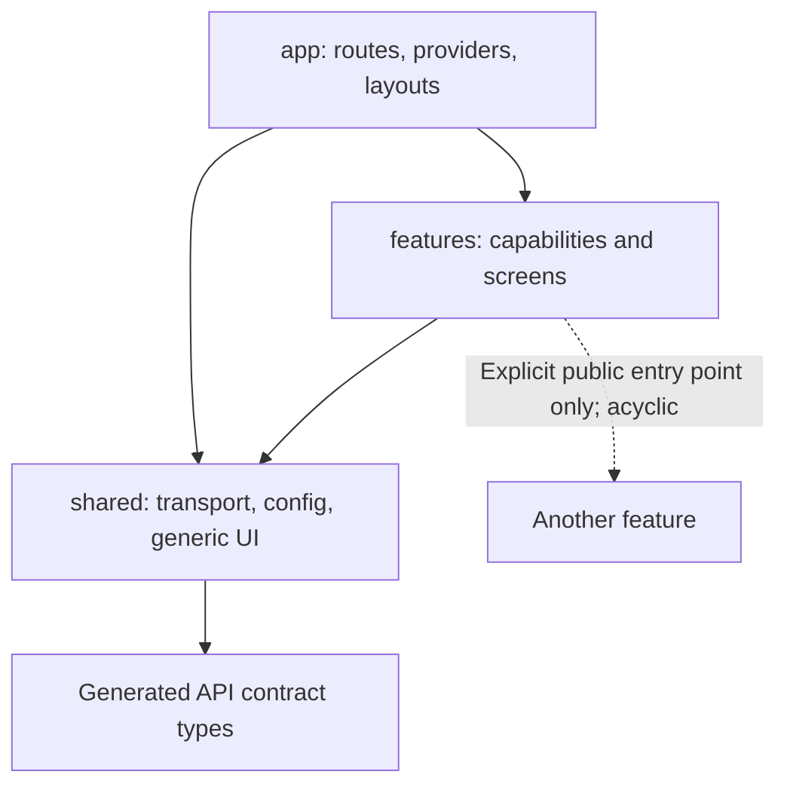

# Frontend Architecture

## Status and approved boundaries

This document describes the `FE/` React, TypeScript, and Vite SPA. The starter includes the shell and tooling; application features remain planned. See [the overview](overview.md), [agent instructions](../../AGENTS.md), and [project scope](../scope.md).

The frontend MUST install, execute, test, and build independently of PHP, MySQL, or a running Laravel API. It communicates with Laravel exclusively through documented REST endpoints. Production API access is a runtime requirement for connected features, not a prerequisite for a static frontend build.

## Feature-Based organization

```text
FE/
├── readme.md                         # Existing file; preserve
├── public/
├── src/
│   ├── app/
│   │   ├── providers/               # Query client, session composition
│   │   ├── router/                  # Declarative routes and route guards
│   │   └── layouts/
│   ├── features/
│   │   └── auth/
│   │       ├── api/                 # Documented HTTP functions and query keys
│   │       ├── components/
│   │       ├── hooks/
│   │       ├── pages/
│   │       ├── schemas/             # Zod form schemas
│   │       └── index.ts             # Deliberate public exports when needed
│   ├── shared/
│   │   ├── api/
│   │   │   └── generated/           # Committed generated contract types
│   │   ├── config/                  # Validated public environment configuration
│   │   ├── lib/                     # Domain-neutral utilities
│   │   └── ui/                      # Reusable presentation primitives
│   └── test/                        # Shared setup, fixtures, API mocks
├── e2e/                             # Playwright tests and configuration
├── package.json
├── package-lock.json
├── tsconfig.json
└── vite.config.ts
```

This is a target structure. Create folders and public barrels only when they have actual content or consumers. Colocate unit and component tests near the code they exercise; keep shared setup under `src/test/`.

## Dependency direction and responsibilities



- The **app layer** composes global providers, routes, layouts, and session transitions. It may coordinate multiple features.
- A **feature** owns its pages, interaction components, form schemas, API functions, and query hooks.
- The **shared layer** contains code without a feature-specific business dependency. It MUST NOT import from `features/` or `app/`.
- A feature MUST NOT deep-import another feature's internal API, hooks, or components. Use an explicit public entry point when sharing is justified and keep dependencies acyclic.
- Promote code to shared only after a real shared responsibility is clear. A generic name is not evidence that code belongs there.
- Frontend features may align with backend capabilities, but their folder structures do not need to mirror backend module internals.

## Application state ownership

| State | Owner | Rule |
| --- | --- | --- |
| Server resources and current user | TanStack Query | One canonical cache; avoid copying into Context or a second store |
| Form values, touched state, submission interaction | React Hook Form | Keep transient values with the form |
| Client input and public configuration validation | Zod | Backend validation and permissions remain authoritative |
| Location, shareable filters, sorting, pagination | React Router and URL parameters | Parse and validate values before API requests |
| Temporary component interaction | Local React state | Examples include an expanded panel or open dialog |
| Global composition and session transitions | App providers | Compose server state rather than duplicate it |

No additional global state library is approved. Evaluate a concrete need before proposing one.

## React Router Declarative Mode

Use React Router Declarative Mode with `BrowserRouter`, `Routes`, `Route`, and `Outlet` as appropriate. Route configuration belongs to the app layer; features export their pages through deliberate entry points.

Do not introduce `createBrowserRouter` loaders, route actions, Framework Mode, SSR, or a second server-data cache under the current baseline. Such a routing-mode change requires explicit approval.

A protected route waits while the current-user query is unresolved, renders permitted navigation when authenticated, and sends guests to the login screen. A frontend guard is a user-experience boundary, not an authorization boundary. Laravel still checks each API request.

Validate post-login return destinations as local application routes to prevent open redirects. An authenticated `403` displays an access-denied state without treating the user as logged out. Client-side error boundaries handle rendering failures separately from documented HTTP errors.

## Axios API client

The planned shared client belongs under `src/shared/api/`. Configure one Axios instance for the trusted backend origin with:

- A validated `baseURL` derived from `VITE_API_ORIGIN`, containing the backend origin without `/api/v1`.
- `withCredentials: true` and `withXSRFToken: true`.
- `Accept: application/json`; JSON content type on JSON requests, without overriding multipart boundaries when an upload is eventually approved.
- A finite timeout selected during implementation and cancellation support using the query's `AbortSignal`.

Feature API functions use explicit versioned paths such as `/api/v1/auth/me`. CSRF initialization uses `/sanctum/csrf-cookie` on the same client. Keeping the origin separate prevents accidentally requesting `/api/v1/sanctum/csrf-cookie`.

Only trusted, application-controlled backend paths may use this instance. Do not accept arbitrary request URLs from users, send its XSRF header to third-party origins, or configure global Axios defaults that affect unrelated clients.

Transport code SHOULD normalize HTTP, network, timeout, and unexpected non-JSON failures into a small, typed error representation. Preserve HTTP status, stable API error code, field errors, and relevant response headers. Do not import the router into the transport layer or turn every failure into a global redirect or toast.

The app's session boundary decides how `401` and `419` affect authentication. Feature forms handle `422` errors, and feature pages handle meaningful `403` or `404` states. See [API conventions](api-conventions.md) and [authentication](authentication.md).

## TanStack Query conventions

- Query hooks call feature API functions; presentation components do not perform raw HTTP requests.
- Define stable query keys near the owning feature's API functions. Include every parameter that changes the result, such as filters, pagination, and relevant authenticated identity.
- The current-user query is the canonical session-identity source. Represent unresolved, guest, authenticated, and failed-connectivity states explicitly.
- Treat `401` from an initial current-user request as the expected guest outcome. Do not redirect repeatedly, repeatedly retry it, or show a generic failure toast for a normal guest.
- Use `enabled` or equivalent query conditions to avoid protected requests before identity is established.
- Set stale time and garbage-collection behavior deliberately for the resource. Do not globally choose infinite freshness or persist protected caches to browser storage.
- Use bounded retries only for suitable transient query failures. Do not retry `401`, `403`, `419`, or `422` automatically; honor throttling policy for `429`.
- Mutations do not retry automatically unless an endpoint has a documented safe idempotency contract. No such contract is assumed initially.
- Invalidate or update the owning query keys after successful mutations. Avoid broad cache invalidation when a narrow update is correct.
- On logout, expiry, or account changes, prevent new protected requests, cancel relevant in-flight queries, clear sensitive query and mutation state, and then establish the next identity.
- Query cancellation must reach Axios through `AbortSignal`. Clearing the cache does not undo server writes or cancel already submitted mutations; stale callbacks from an old identity must not repopulate the new user's cache.

Do not duplicate current-user data in a separate authentication store. A provider may expose a convenient view of the query and session operations without becoming another source of truth.

## React Hook Form and Zod

Keep form schemas with their feature. Use React Hook Form to manage values and interaction, and integrate Zod through a compatible resolver selected when the dependency is added.

Client validation SHOULD provide prompt, accessible feedback for required fields and known structural constraints. Laravel still validates every submitted request and enforces business rules such as uniqueness and authorization.

Map backend dot-path validation errors to the appropriate form fields. Errors that do not map safely to a field belong in a form-level message. Invalid login credentials use a generic message and must not reveal whether an account exists.

Avoid aggressive transformations that silently change user intent, and never trim or normalize passwords. Prevent accidental repeated submissions, preserve appropriate input after ordinary validation failures, and never persist credentials or session identifiers in localStorage or sessionStorage.

OpenAPI describes the wire contract; Zod describes client-side validation at selected boundaries. Do not create a second business-rule specification or claim that generated TypeScript types perform runtime validation.

## Types, naming, and UI conventions

- Enable strict TypeScript and narrow unknown errors explicitly. Do not hide incompatibilities with unexplained assertions or `any`.
- Use PascalCase component names and component filenames, `use`-prefixed hook names, and descriptive camelCase variables and functions. Use consistent, descriptive filenames for other modules.
- Wire fields remain `snake_case` as defined by generated contract types. Use camelCase in a local view model only through a deliberate, typed mapping; do not introduce a global automatic case converter.
- Keep components focused on interaction and rendering. Extract hooks or components when behavior or reuse justifies it.
- Use semantic HTML, labels, keyboard interaction, and accessible loading/error states. A UI library and formal accessibility/browser targets remain product decisions; none is installed or assumed.
- Do not render untrusted HTML without a reviewed sanitization requirement. Frontend environment variables must contain public configuration only.

## API types and independent builds

The planned source contract is `docs/api/openapi.yaml`, pinned to OpenAPI 3.1.2. Generated TypeScript files belong under `src/shared/api/generated/` and are committed. The exact generator is to be selected and pinned; `openapi-typescript` is a recommendation, not an installed tool or a replacement for Axios.

Feature API functions derive request and response types from the generated contract. They do not maintain duplicate handwritten copies of shared API DTOs. Generated files must not be edited manually.

Regeneration and drift checks use the local reviewed contract and do not require a live Laravel application. Ordinary builds consume committed output. A backend contract test separately verifies that Laravel's implementation matches the same contract.

## Frontend testing strategy

| Tool or level | Required behavior |
| --- | --- |
| Vitest unit tests | Pure utilities, parsing, selected Zod schemas, query-key construction, and error normalization |
| Vitest component/integration tests | User interactions, form errors, loading states, query outcomes, route guards, and session transitions |
| HTTP boundary mocks | Documented endpoint shapes and failures, without coupling tests to Axios implementation internals |
| Type checking and production build | Contract compatibility and independent frontend artifact creation |
| Playwright | Real backend login, cookies, CORS, CSRF, reload persistence, logout, expiry, and cross-user cache isolation |

Use isolated query clients and deterministic fixtures in tests. Disable query retries where they obscure assertions. Mock external effects at their boundaries, and keep request/response fixtures consistent with OpenAPI.

React Testing Library, jsdom, linters, and formatters are installed in the starter. MSW is a recommendation for future HTTP mocking. Playwright is the E2E runner; install its browser binary per machine.

Vitest mocks cannot prove real browser cookie enforcement or credentialed CORS. Playwright must run the frontend and backend with the documented distinct origins and request-forgery protection active for those checks. Never use production accounts or databases for E2E tests.

## References

- [Architecture overview](overview.md)
- [Backend architecture](backend.md)
- [Authentication](authentication.md)
- [API conventions](api-conventions.md)
- [Project scope](../scope.md)
- [React Router modes](https://reactrouter.com/start/modes)
- [TanStack Query documentation](https://tanstack.com/query/latest/docs/framework/react/overview)
- [Axios request configuration](https://axios-http.com/docs/req_config)
- [React Hook Form documentation](https://react-hook-form.com/get-started)
- [Zod documentation](https://zod.dev/)
- [Vitest guide](https://vitest.dev/guide/)
- [Playwright documentation](https://playwright.dev/docs/intro)
