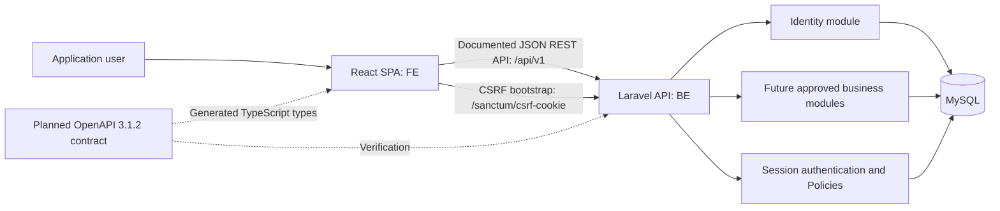
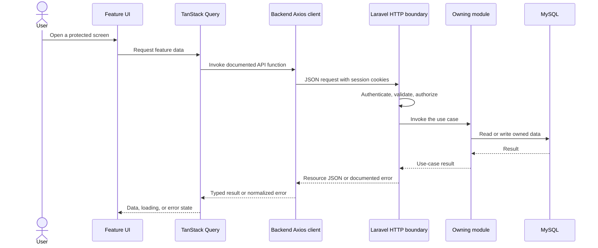

# Architecture Overview

## Status and terminology

This document records the approved architecture. The starter implements the foundations described here; application-level structures remain planned.

**MUST** and **MUST NOT** identify mandatory standards. **SHOULD** identifies a recommendation whose deviation needs an explanation. Changes to the approved baseline require explicit approval regardless of wording. The [agent instructions](../../AGENTS.md) govern repository work, and the [project scope](../scope.md) records what is included.

## Approved technology baseline

| Concern | Decision |
| --- | --- |
| Repository | Monorepo; independent `BE/` and `FE/` roots |
| Backend | Laravel 13; Modular Monolith |
| Frontend | React, TypeScript, Vite; Feature-Based Architecture |
| Communication | Documented REST APIs; application prefix `/api/v1` |
| Authentication | Laravel Sanctum SPA Cookie Authentication |
| Persistence | MySQL |
| Routing | React Router Declarative Mode |
| HTTP | Axios |
| Server state | TanStack Query |
| Forms and frontend validation | React Hook Form and Zod |
| Testing | Pest, Vitest, and Playwright |
| Contract | OpenAPI 3.1.2 and generated TypeScript types |
| Deployment | Provider-neutral; undecided |

PHP 8.5, Node.js 24 LTS, and MySQL 8.4 are the runtime baselines. Exact resolved versions are recorded in the application manifests and lockfiles.

## System context



The arrows describe logical dependencies, not separate deployable services. The backend remains one Laravel application with in-process module calls and one MySQL database initially. Future business modules require confirmed product requirements.

## Monorepo organization

The target monorepo layout is (planned directories are marked):

```text
project-root/
├── AGENTS.md
├── BE/                         # Independent Laravel application
│   ├── readme.md                # Existing file
│   ├── app/Modules/             # Planned capability boundaries
│   ├── app/Providers/           # Laravel and module registration
│   ├── app/Support/             # Proven shared infrastructure only
│   ├── database/                # Ordered migrations, factories, seeders
│   ├── tests/                   # Pest tests
│   ├── composer.json            # Backend dependency manifest
│   └── composer.lock            # Backend lockfile
├── FE/                         # Independent React application
│   ├── readme.md                # Existing file
│   ├── src/app/                 # Composition, routing, providers
│   ├── src/features/            # User-facing capabilities
│   ├── src/shared/              # Domain-neutral shared code
│   ├── src/test/                # Shared test setup and fixtures
│   ├── e2e/                     # Playwright browser tests
│   ├── package.json             # Frontend dependency manifest
│   └── package-lock.json        # Frontend lockfile
└── docs/
    ├── architecture/            # Architecture documents
    ├── development/             # Standards, testing, workflow
    ├── setup/                   # Setup, environment, troubleshooting
    ├── verification/            # Verified baseline
    ├── api/openapi.yaml         # Planned contract; not created in the starter
    └── scope.md
```

Directories are created only when needed. Composer and npm remain scoped to their applications. A root npm workspace, root dependency manifest, and monorepo orchestrator are not required.

Generated TypeScript types will be committed under `FE/src/shared/api/generated/`. Normal frontend builds MUST use those files without running PHP, connecting to MySQL, starting the backend, or fetching a remote contract. Regeneration is a separate contract-maintenance check.

Backend installation, execution, testing, and production preparation MUST NOT require frontend installation or a Node.js asset build. The backend will expose its `public/` entry point; the frontend will produce its own static artifact. Their release compatibility is governed by the API contract, even though builds are independent.

## Responsibility boundaries

| Boundary | Responsibilities | Exclusions |
| --- | --- | --- |
| Backend HTTP layer | Routing, request validation, authentication integration, resource serialization, error translation | Presentation state and browser navigation |
| Backend modules | Business rules, use cases, model ownership, transactions, authorization integration | Another module's private tables, models, or HTTP adapters |
| MySQL | Durable application data and initial database-backed sessions | Frontend access or independent business authorization |
| Frontend app layer | Providers, layouts, routing, application-wide session transitions | Duplicating business rules or feature internals |
| Frontend features | Screens, interaction, feature API functions, query hooks, forms | Direct database access or authoritative permissions |
| Frontend shared layer | Trusted transport, generated types, generic UI and utilities | Imports from feature or app code |
| OpenAPI contract | Reviewed public request/response shapes and security requirements | Replacing backend runtime validation or business rules |

Backend and frontend implementation details MUST NOT cross the HTTP boundary. Sharing the repository does not permit importing backend models into the SPA. Backend modules may communicate through documented in-process public interfaces; they MUST NOT call one another through internal REST endpoints.

## Communication flow



The [authentication document](authentication.md) defines session bootstrap and logout separately. The [API conventions](api-conventions.md) define envelopes, field naming, errors, and versioning.

## Architectural principles

1. **Backend authority:** Laravel enforces all business invariants and permissions. Client validation is helpful feedback only.
2. **Explicit boundaries:** Modules own capabilities; features own user interaction. Dependencies remain visible and acyclic.
3. **Independent applications:** Neither build depends on the other's runtime or asset pipeline.
4. **Contract discipline:** Endpoint behavior, OpenAPI, generated types, and tests evolve together.
5. **Incremental structure:** Use Laravel and React conventions before introducing abstractions. Extract shared code after a concrete need exists.
6. **Security by lifecycle:** Test login, identity changes, expiration, and authorization failures in addition to happy paths.
7. **A modular monolith first:** Expand modules inside the application. Do not add microservices or distributed messaging speculatively.

## Deployment-neutral design and origin constraints

No deployment provider, container platform, reverse proxy, CI platform, CDN, or hosting layout has been selected. This architecture permits independently built frontend and backend artifacts while retaining cookie-compatible public origins.

The production topology MUST use either:

- A same-origin public entry point that routes API and security-bootstrap requests to Laravel; or
- Separate frontend and API subdomains under the same registrable site domain, using HTTPS and the required CORS/cookie configuration.

Same-origin routing simplifies browser security configuration and permits narrower cookies. Separate subdomains support independently exposed origins but require credentialed CORS and careful shared-cookie trust. Provider-neutral does not mean that arbitrary unrelated public domains satisfy Sanctum SPA authentication.

Database-backed sessions are the initial design, avoiding a mandatory Redis dependency. Additional backend instances must share the session store and consistent encryption configuration. Queue workers, cache infrastructure, and other processes are added only when a confirmed feature requires them.

## Open decisions and change control

The following remain unresolved and MUST NOT be fabricated during implementation:

- Product domain, first business capability, and business module names.
- Account provisioning, registration, recovery, email verification, MFA, and persistent-login scope.
- Roles, permissions, tenancy, and account isolation requirements.
- UI styling system, accessibility targets, browser support, and localization needs.
- Product-specific identifier representations, retention rules, and concurrency or idempotency requirements.
- Exact package versions and supporting development tools, including the OpenAPI validator and type generator.
- Production origins, session lifetime policy, infrastructure, deployment provider, and operational objectives.

Do not change an approved decision to resolve an issue silently. Record the conflict, explain alternatives and trade-offs, and obtain approval before an architectural change. The [project scope](../scope.md) identifies what is included.

## Related documents and framework references

- [Backend architecture](backend.md)
- [Frontend architecture](frontend.md)
- [Authentication architecture](authentication.md)
- [API conventions](api-conventions.md)
- [Project scope](../scope.md)
- [Laravel 13 release notes](https://laravel.com/docs/13.x/releases)
- [Pest installation requirements](https://pestphp.com/docs/installation)
- [Vite guide](https://vite.dev/guide/)
