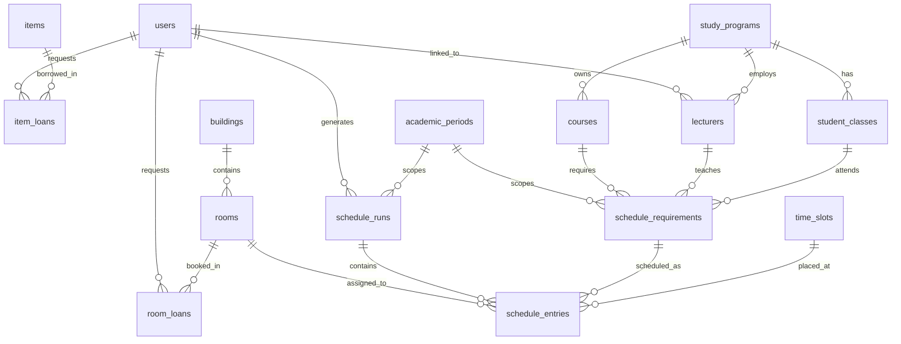

# Database Schema & Setup Guide

Dokumen ini merangkum skema database MySQL 8.4 untuk **Sistem Informasi Akademik UPI Kampus Cibiru** (tanpa modul pengajuan surat mahasiswa) beserta langkah penyiapan lokal bagi seluruh anggota tim.

## Entity Relationship Diagram



## Daftar Tabel & Kepemilikan Modul

| Urutan Migrasi | Tabel | Modul | Fungsi Utama |
| --- | --- | --- | --- |
| `000000`–`000003` | `users`, `sessions`, `password_reset_tokens` | Identity | Autentikasi Sanctum SPA, peran (`admin`, `mahasiswa`, `dosen`, `staff`), `nim_nip`, status aktif |
| `000004` | `buildings`, `rooms`, `items` | Facilities | Master gedung (untuk Mind Mapping per gedung), ruangan, kapasitas, dan stok barang |
| `000005` | `room_loans`, `item_loans` | Loans | Pengajuan, persetujuan, penolakan, dan riwayat peminjaman ruangan & barang |
| `000006` | `study_programs`, `academic_periods`, `lecturers`, `courses`, `student_classes`, `time_slots` | Academic | Data master akademik, warna prodi (`color_hex`), preferensi hari dosen, dan slot waktu |
| `000007` | `schedule_requirements`, `schedule_runs`, `schedule_entries` | Scheduling | Kebutuhan jadwal, hasil generate, skor konflik, approval, dan sumber matriks Mind Mapping |
| `000008` | `notifications` | Notifications | Notifikasi umum sistem (status peminjaman & approval jadwal) |

## Pemisahan Hard vs Soft Constraints (Penjadwalan)

- **Hard Constraints** (wajib `0` pelanggaran sebelum `schedule_runs.status` bisa menjadi `approved`):
  - Tidak ada bentrok ruangan pada `day_of_week` + `time_slot_id` yang sama.
  - Tidak ada bentrok dosen maupun kelas mahasiswa (`student_class_id`) pada waktu yang sama.
  - Kapasitas ruangan (`rooms.capacity`) mencukupi `schedule_requirements.required_capacity` dan tipe ruangan sesuai (`requires_lab` / `preferred_room_type`).
- **Soft Constraints** (dihitung ke `schedule_runs.soft_score`):
  - Preferensi hari mengajar dosen (`lecturers.preferred_days`).
  - Batas SKS harian dosen (`lecturers.max_sks_per_day`).
  - Pemerataan distribusi jadwal agar tidak menumpuk di satu hari.

## Langkah Setup Tim (Lokal)

1. **Backend (`BE/`)**
   - Salin `BE/.env.example` menjadi `BE/.env` dan sesuaikan `DB_DATABASE=friday_dev`, `DB_USERNAME`, serta `DB_PASSWORD`.
   - Buat database MySQL `friday_dev` dan `friday_test`.
   - Jalankan:
     ```bash
     cd BE
     composer install
     php artisan key:generate
     php artisan migrate
     ```
2. **Frontend (`FE/`)**
   - Salin `FE/.env.example` menjadi `FE/.env` (jika ada konfigurasi `VITE_API_ORIGIN=http://localhost:8000`).
   - Jalankan:
     ```bash
     cd FE
     npm install
     npm run dev
     ```
   - Buka `http://localhost:5173/design-system` untuk melihat panduan visual langsung di browser.
